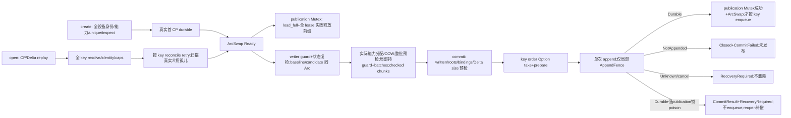

# 七模块壳结构与流程

## 2026-10-12 Runtime 闭包

P1/P2 修复与旧测试迁移基线为SB默认222/test-support224、file69/block25。新增公开Transaction::commit多设备动态验收2项后，完整workspace --all-targets --features pi_superblock/test-support --locked --offline实际通过SB226/file69/block25，共320项不重复harness测试；完整workspace严格Clippy -D warnings通过。三个真实FileBlockDevice适配器逆序写入、同步begin归属正确，channel gate位于实际消费式prepare调用前：低key Pending阻止高key触发，逐gate阶段真实metadata replay与publication保持旧值；release全部gate并await真实prepare后仅新增一条durable Delta，root/binding/mmap与seq一致，退休登记回调看到新publication而非旧视图。key2受控prepare失败阻止key3，log不变、TX关闭/writer释放、所有文件字节保留；释放旧owner后同ID unsafe reopen/reconcile再commit/read成功。首次编译成功即通过记为验收，不制造RED。open仅扫描真实介质孤儿，不按历史ID枚举；durable后publication锁失败保留旧发布视图，不enqueue，返回CommitResult+RecoveryRequired并由reopen补偿。metadata Pending取消/native Unknown、APP visitor/诊断与production maintenance接口缺口未关闭。

此节优先于以下历史节点的 TODO/未实现标签。SB create/open/open_snapshot/begin、TX get_binding/admissibility/read/write_on/write_batch/stream/commit 已实现，src TODO 11->0。公开 production 签名未新增；纯查询保持无状态副作用。未恢复 TxnID、baseline leases、phase/closed/WriteGuard。

TX read 只捕 baseline/candidate/devices/status/guard存在值，不捕整体 !Sync batches；临时 lease 仅保护本次 read，不承诺 whole-baseline protection。guard None 表示关闭，无新 permanent phase。日志仍 Arc+统一 operation_gate+pending queue；无自动回收 worker。APP visitor/getter/query/生产维护入口未批准，不补签名或默认验证成功；append 与 late failure source 无现有公开通道，精确诊断验收缺口保留。多设备prepare等待顺序已有上述channel动态验收，不代表metadata append Pending取消/native Unknown已验收。

## 2026-10-12 纯状态闭环

指定15处私有实现已落盘，26->11；RG构造/borrow view/state路径、AP/SN device_state、CP七处codec及CH原子candidate与allocation active position均实。CP顺序为registry逐项registration+State、roots、bindings、application remainder，无新wire字段/serde。S codec自行检查完整remainder，无consumed contract。用户明确选择保留现有RecordTooLarge/InvalidBlockRef/InvalidState carrier，Feature13 InternalValidationKind分类缺口保留。仅此闭环验收，不等于create/open/commit、visitor或维护端到端完成。

## 2026-10-11 落地进度（历史）

本轮续作实测：固定nightly-2026-08-17-i686-pc-windows-gnu，SB lib18及真实文件日志4、file69、block25通过；workspace lib/test-support lib检查通过但仍有40项骨架warning。严格Clippy -D warnings失败45项，不添加豁免。维护接线传checkpoint TODO，不声明完整runtime完成；Cargo/lock/features本轮未变，无crossbeam。

本次授权后已独立落地 backend 同步 `begin_write_batch(self: &Arc<Self>) -> Result<Self::WriteBatch, DeviceError>` 与 file 延迟加锁。首次 write await write_gate，锁后重检围栏，持锁至消费式 prepare 完成或 Drop；未写批次不阻塞非空 reclaim，空轮仍立即全零。等待锁期间取消不发起 I/O、不置 fence；既有 durable failure、flush cancel、删除准入与 mapping-last-drop 保护保留。同步签名迁移编译错误不是 TDD RED；旧实现下未写批次占锁的公开行为测试成功编译后真实失败，随后修复。

2026-10-11 最新决定已落地：SB 直接 ArcSwap<State>、SmallVec<[Arc<D>;4]> 和必要 runtime；Transaction<'a,S,C,D,R> 无 owner，只借具体字段，Option<async_lock::MutexGuard<'a,()>>，commit保留 &mut self。删除ID/allocator/baseline_leases/custom gate/permit/phase/closed/WriteGuard；snapshot leases 不删。baseline/candidate 初始同一Arc、首次mut COW为begin明确TODO合同，不是runtime已完成。

基线26处todo（历史）：本轮完成两个上层维护接线，checkpoint编码仍TODO，未完成create/open/commit。此前删WriteGuard3处、新增准入1处，30->28仅骨架简化，未实现commit成功。公有Transaction lifetime、begin输出及删除ID导出/hidden injection是批准签名变化，不能声称历史56不变。精确arc-swap=1.9.2/smallvec=1.15.2均原锁/缓存版本，正常offline resolver只新增直接边，不升级无关包。file69/block25/SB lib12（原10+2最小类型/长度检查）通过；完整记录见WORK。无commit/task/external mods。

## 0. 历史骨架图与核对记录（非当前源码状态）

以下第 0–14 节保留结构设计与逐项核对历史，含尚未更新的 TODO 标签和已删除的 helper 名称。当前实现、零占位和最新验收以文首 Runtime 闭包为准；不要以历史节点判断当前可运行性。

本文件记录2026-10-11批准的SB/TX代码骨架与当前源码，非完整runtime验收。保留全部已有未提交修改，file/block源码不改；必要更新现有文档及直接依赖，不新增未批准API，不提交/派发task/修改外部源码。

本轮存在批准的Transaction生命周期/ID导出签名变化；此前 shell 56 public signature 对照是已有任务证据，不是本轮重新计算的方法总数。本轮不按该历史数字决定清单范围。下文还覆盖 trait 方法、literal helpers、crate-private 入口和必要 Drop，不能与该统计口径混同。

状态标记：

| 标记 | 含义 |
| --- | --- |
| 实 | 当前源码有真实方法芯；不等于端到端验收 |
| 传 TODO | 方法芯存在，但所调用路径含未实现方法 |
| TODO | 当前直接 todo!；同步调用或 future 被 poll 时可能 panic |
| 契约目标 | 来自当前冻结 feature，虚线展示；不是伪装成现有源码 |
| 缺声明 | feature/用户待确认项，无当前批准签名，不得自行补 API |
| 已核对应 | 本轮已逐模块核对源码字段、签名、可见性与图表；不代表实现完成 |
| 待确认 | 契约缺口或现有声明冲突保留，未新增裁决/API |

图节点使用唯一 ID（Mermaid 内部用下划线，标签显示连字符）。结构节点包含字段/类型概要，完整字段类型在相邻表或声明块；方法节点和签名表按同一 ID 对应。实线为已有关系/方法芯，虚线为未实现目标。每图在本节语境内独立可读，不把日志支撑模块当第八壳。

当前11处私有todo：SB implementation4；TX implementation4/write2/stream1。2026-10-12实现RG4/SN1/AP1/CH1/CP7/allocation1，共15处，26->11。无终态/跨事务身份/事务整体基准物理保护；snapshot leases/ReadBuf安全合同保留。

当前故障模型明确排除新文件名、rename/remove 目录项突然掉电未落盘；数据完整、真实 await 的必要文件 DataAndMetadata sync、操作错误、原子 noreplace、取消及进程退出恢复仍在范围。文件 sync 不是父目录 fsync，也不是其它句柄未完成 I/O 的全局屏障。

来源：
- [当前规则说明](design/features/RULES.md) 的当前分类段落；不使用其历史 index/统计推断当前合同。
- [当前 Superblock 依赖](crates/pi_superblock/Cargo.toml)：rpds =1.1.0、pi_append_log 本地 D:/dev/pi_append_log =0.4.0、pi_async_fs =0.1.2；默认 features 空，test-support 可选。
- [当前文件后端依赖](crates/pi_file_block_device/Cargo.toml)：pi_async_fs =0.1.2。本轮只读取 workspace 使用方，不访问或修改外部依赖源码。
- 当前已读取 [01 固定协议](design/features/01-fixed-protocol.feature)、[02 注册能力](design/features/02-registry-capabilities.feature)、[03 batch](design/features/03-backend-session.feature)、[04 reconcile/retire](design/features/04-reconcile-retire.feature)、[05 create](design/features/05-create-validation.feature)、[06 open](design/features/06-open-recovery.feature)、[07 snapshot](design/features/07-snapshot-blockref.feature)、[08 transaction](design/features/08-transaction-changes.feature)、[09 Bytes/stream](design/features/09-bytes-stream.feature)、[10 application](design/features/10-application.feature)、[11 commit](design/features/11-commit-outcomes.feature)、[12 maintenance](design/features/12-recordseq-maintenance.feature)、[13 wire](design/features/13-wire-format.feature)、[14 e2e](design/features/14-three-device-e2e.feature)、[15 发布](design/features/15-release-metadata.feature)、[16 架构](design/features/16-architecture-boundaries.feature)。链接不附猜测行号。

## 1. 七模块与支撑边界

| 编号 | 壳 | 职责 | 方法芯/支撑实际路径 |
| --- | --- | --- | --- |
| 1 SB | [superblock.rs](crates/pi_superblock/src/superblock.rs) | 生命周期、当前 publication、状态、读/写入口 | [implementation](crates/pi_superblock/src/superblock/implementation.rs)、[support](crates/pi_superblock/src/superblock/support.rs) |
| 2 TX | [transaction.rs](crates/pi_superblock/src/transaction.rs) | candidate、有序 changes、线性分配凭证、物理写调度、未实现提交 | [implementation](crates/pi_superblock/src/transaction/implementation.rs)、[allocation](crates/pi_superblock/src/transaction/allocation.rs)、[release](crates/pi_superblock/src/transaction/release.rs)、[write](crates/pi_superblock/src/transaction/write.rs)、[stream](crates/pi_superblock/src/transaction/stream.rs) |
| 3 RG | [registry.rs](crates/pi_superblock/src/registry.rs) | 静态 registration 与动态 persistent state 拆分表、borrowed view | [implementation](crates/pi_superblock/src/registry/implementation.rs) |
| 4 SN | [snapshot.rs](crates/pi_superblock/src/snapshot.rs) | 固定 State、强 backend 引用、全设备 lease、只读 trait | [implementation](crates/pi_superblock/src/snapshot/implementation.rs) |
| 5 AP | [application.rs](crates/pi_superblock/src/application.rs) | 应用状态/codec 合同、前视图 context、有界 encoder、名称 | [implementation](crates/pi_superblock/src/application/implementation.rs) |
| 6 CP | [format/checkpoint.rs](crates/pi_superblock/src/format/checkpoint.rs) | 完整 State checkpoint body codec | [implementation](crates/pi_superblock/src/format/checkpoint/implementation.rs) |
| 7 CH | [change.rs](crates/pi_superblock/src/change.rs) | 有序 System/Application change 表示与受控逻辑应用 | [implementation](crates/pi_superblock/src/change/implementation.rs) |

额外支撑不是第八壳：[lib 导出](crates/pi_superblock/src/lib.rs)、[state/liveness](crates/pi_superblock/src/state.rs)、[error](crates/pi_superblock/src/error.rs)、[capability](crates/pi_superblock/src/capability.rs)、[header](crates/pi_superblock/src/format/header.rs)、[delta](crates/pi_superblock/src/format/delta.rs)、[segment delta helpers](crates/pi_superblock/src/format/delta/segment.rs)、[wire Reader](crates/pi_superblock/src/format/wire.rs)、[limits](crates/pi_superblock/src/format/limits.rs)、[format 导出](crates/pi_superblock/src/format/mod.rs)、[append_log](crates/pi_superblock/src/append_log.rs)、[log codec](crates/pi_superblock/src/append_log/codec.rs)、[log recovery](crates/pi_superblock/src/append_log/recovery.rs)、[log maintenance](crates/pi_superblock/src/append_log/maintenance.rs)。以上均读取当前文件。

共同类型：S: ApplicationState；C: ApplicationCodec<S>；D: BlockDeviceBackend；R: DeviceResolver<D>。后端 Send+Sync+'static，SnapshotLease Send+Sync+'static，ReadBuf: ProtectedReadBuf<Lease=D::SnapshotLease>（AsRef<[u8]>+Send+'static），WriteBatch 只要求 Send+'static，不要求 Sync/Clone。Arc State/持久集合不能取代snapshot lease/ReadBuf或publication_access物理协调。

共享 State 支撑实际字段（[state.rs](crates/pi_superblock/src/state.rs)）：

~~~rust
pub struct SuperblockState<S: ApplicationState> {
    pub record_seq: RecordSeq,
    pub devices: DeviceTable,
    pub roots: RedBlackTreeMapSync<BlockRef, RecordSeq>,
    pub bindings: RedBlackTreeMapSync<BindingName, BlockRef>,
    pub application: S,
}
pub enum SuperblockStatus { Ready, ReadOnlyExhausted, RecoveryRequired }
pub struct RecoveredState<S: ApplicationState> {
    pub state: SuperblockState<S>, pub status: SuperblockStatus,
}
~~~

State/RecoveredState/Status 经根 lib doc(hidden) 导出，hidden 不等于 crate-private。rpds Sync aliases 是结构共享集合，当前 feature 明确 ArcTK/triomphe::Arc，不是默认 Rc。std::sync::Arc 是 publication/registration/backend 的外层共享所有权。应用 S 的廉价 Clone 由应用自己负责。

## 2. SB：superblock

### 2.1 当前结构

SB-S1 Superblock<S,C,D,R> 保留四个泛型，R 用于 create/open resolver；所有字段 private。State 仅逻辑状态，不混入 backend/log/锁。没有 OuterArc 或大 Inner。

| 字段 | 实际类型 | 所有权/约束 |
| --- | --- | --- |
| log | Arc<SuperblockAppendLog> | 稳定共享日志；内部原子/短锁，外部writer全程串行 |
| resolver / codec | Arc<R> / Arc<C> | SB owner，create 不 resolve |
| devices | SmallVec<[Arc<D>; INLINE_DEVICES]> | 私有 INLINE_DEVICES=4 是内联容量，不是设备上限；超出 spill |
| published | ArcSwap<SuperblockState<S>> | 直接发布槽，无 outer Arc；load_full 克隆 Arc |
| publication_access | Mutex<()> | lease 获取与未来发布的协调锁，不是 State owner；当前 read 使用，snapshot/commit 接入 TODO |
| status | Arc<AtomicStatus> | private AtomicU8安全封装，Acquire读取/AcqRel单调更新，Recovery不被Ready覆盖 |
| writer_gate | async_lock::Mutex<()> | 事务借用guard；显式维护全程覆盖rotate/checkpoint/publication/archive |

SB-S2 InitialDevice<D> 仍 pub label:DeviceLabel/device:Arc<D>；SB-S3 LogConfig 仍 pub path:PathBuf/rotate_threshold:u64/append_log_options:AppendOptions。SB-S4 DeviceResolver<D>:Send+Sync+'static；SB-S5 ResolveError 仍 pub device_key/source，Debug/Display/Error 保留来源。

~~~mermaid
flowchart TB
  SB_S1["SB-S1 Superblock S C D R: runtime owner; direct ArcSwap; SmallVec Arc D; mutexes"]
  SB_S2["SB-S2 InitialDevice label/backend"] --> SB_01["SB-01 create -> Send static future TODO"]
  SB_S3["SB-S3 LogConfig path/threshold/options"] --> SB_01
  SB_S3 --> SB_02["SB-02 open -> Send static future TODO"]
  SB_S1 --> SB_01 & SB_02
  SB_S1 --> SB_03["SB-03 status 实 / SB-09 Debug 实"]
  SB_S1 --> SB_04["SB-04 open_snapshot TODO: leases retained"]
  SB_S1 --> SB_05["SB-05 read: coordination lock + load_full + temporary lease;RG实"]
  SB_S1 --> SB_06["SB-06 begin_write -> Transaction a S C D R TODO"]
  SB_S1 --> SB_07["SB-07/08 explicit maintenance;writer全程;CP编码实，完整维护未验收"]
  SB_S4["SB-S4 Resolver"] --> SB_10["SB-10 resolve borrowed registration"]
  SB_S5["SB-S5 ResolveError"] --> SB_11["SB-11 Display / SB-12 Error source"]
~~~

### 2.2 方法清单

FSend<T,'a> 仅文档缩写为 impl Future<Output=T>+Send+'a，不是新 Rust alias。

| ID | 签名/可见性 | 当前方法芯 |
| --- | --- | --- |
| SB-01 | pub create(log:SuperblockLogConfig,devices:Vec<InitialDevice<D>>,resolver:Arc<R>,codec:Arc<C>,initial_state:S)->FSend<Result<Self,CreateError>,'static> | create_impl TODO |
| SB-02 | pub open(log:SuperblockLogConfig,resolver:Arc<R>,codec:Arc<C>)->FSend<Result<Self,OpenError>,'static> | open_impl TODO |
| SB-03 | pub status(&self)->SuperblockStatus | status_impl AtomicStatus Acquire读取 |
| SB-04 | pub open_snapshot(&self)->Result<SuperblockSnapshot<S,D>,SuperblockError> | coordination/load_full/全设备 lease TODO |
| SB-05 | pub read(&self,block:BlockRef)->FSend<Result<D::ReadBuf,SuperblockError>,'_> | 先 RecoveryRequired，publication_access 同步锁内 load_full、live/key/backend/state 检查和 acquire lease，锁外 await read；注入 operation/key/source；RG实 |
| SB-06 | pub begin_write(&self)->FSend<Result<Transaction<'_,S,C,D,R>,SuperblockError>,'_> | begin_write_impl TODO：借 guard，重检状态，load_full baseline，Arc::clone candidate，borrow 字段；不 State clone、不 baseline leases |
| SB-07 | cfg(test-support) doc(hidden) pub async run_log_maintenance(&self)->Result<MaintenanceOutcome<S>,MaintenanceError> | H01接线实，未完整维护验收 |
| SB-08 | cfg(test-support) doc(hidden) pub async run_pending_maintenance(&self)->同上 | H02转H01，CP编码实，完整维护未验收 |
| SB-09 | Debug::fmt(&self,&mut Formatter<'_>)->fmt::Result | debug_impl status only |
| SB-10 | DeviceResolver::resolve<'a>(&'a self,key:DeviceKey,registration:&'a DeviceRegistration)->FSend<Result<Arc<D>,ResolveError>,'a> | required trait 方法 |
| SB-11/12 | ResolveError Display::fmt / Error::source(&self)->Option<&(dyn Error+'static)> | raw key/source 输出；Some(source.as_ref()) |

~~~mermaid
flowchart LR
  SB_R01["SB-R01 status check"] --> SB_R02["SB-R02 publication_access lock; load_full"]
  SB_R02 --> SB_R03["SB-R03 live/key/backend/state; RG get实"]
  SB_R03 --> SB_R04["SB-R04 同协调锁内 acquire temporary lease"]
  SB_R04 --> SB_R05["SB-R05 锁外 await backend read; typed error context"]
  SB_R05 --> SB_R06["SB-R06 ReadBuf retains own protection"]
~~~

ArcSwap 本身不保护物理对象。future commit/snapshot 必须使用同一 publication_access 协调；仍未接入，不把有锁字段等同 runtime 完成。

### 2.3 私有支撑方法

| ID | 签名/可见性 | 当前方法芯 |
| --- | --- | --- |
| SB-H01 | pub(crate) async run_log_maintenance_internal(&self)->Result<MaintenanceOutcome<S>,MaintenanceError> | writable -> writer_gate ->重检 ->显式条件 ->adapter维护 ->publication_access内store/status ->archive ->最后释放writer；CP编码实，完整维护未验收 |
| SB-H02 | pub(crate) async run_pending_maintenance_internal(&self)->同上 | 转H01，无后台请求 |
| SB-H05 | pub(super) ensure_writable_status(Status)->Result<(),SuperblockError> | Ready Ok；Exhausted/Recovery 拒绝，真实检查保留 |
| SB-H06/07 | pub(super) async reconcile_with_retry<D>(&Arc<D>,Arc<BlockDeviceState>)->Result<(),ReconcileError>；private is_retryable(kind)->bool | 最多3次，仅 RepairIo/MediaMetadataSync/ConcurrentMutation，expected Arc clone |
| SB-H08 | pub(super) validate_config(&LogConfig,device_count:usize)->Result<(),CreateError> | 0/>1,000,000/threshold0 拒绝；容量4不改变上限 |
| SB-H09/10/11 | create_device_key/open_device_key(index:usize)->Result<DeviceKey,CreateError/OpenError>；private checked_device_key(index)->Result<DeviceKey,DeviceKeyIndexError> | checked+1/u32/nonzero，错误 context 保留 |
| SB-H12 | pub(super) recovery_error(Option<DeviceKey>,RecoveryFailureKind,RecoveryOperation,BoxError)->OpenError | literal context |
| SB-H13 | pub(super) map_create_codec(SuperblockError)->CreateError | TooLarge/Codec/其它真实分类保留 |

日志不借出或恢复。MaintenanceStatus传播取消/发布失败围栏；MaintenanceAttempt只覆盖日志rotate/checkpoint不确定区间。ArchiveRound拥有本轮责任，Drop短锁归还，不await、不unlink，不是事务WriteGuard。原错误carrier/source保留。

## 3. TX：transaction

### 3.1 当前字段与生命周期

TX-S1 Transaction<'a,S,C,D,R> 不持 owner Superblock，也不借整个 Superblock。全部字段 pub(crate)。R 无 runtime 使用，仅保留 PhantomData<R> 避免无授权泛型改面。

~~~rust
candidate: Arc<SuperblockState<S>>,
published_at_begin: Arc<SuperblockState<S>>,
changes: Vec<TransactionChange<S::Delta>>,
_codec: &'a C,
devices: &'a [Arc<D>],
batches: Vec<Option<D::WriteBatch>>,
_marker: PhantomData<R>,
published: &'a ArcSwap<SuperblockState<S>>,
publication_access: &'a Mutex<()>,
log: &'a SuperblockAppendLog,
status: &'a AtomicStatus,
writer_guard: Option<async_lock::MutexGuard<'a, ()>>,
allocations: Vec<AllocationRecord>,
~~~

baseline/candidate 初始同一对象，只 Arc clone；首次修改 Arc::make_mut。system/release 保留原子成功后替换算法：局部 next 为 Arc::clone(candidate)，首次 mut 才 COW，失败不替换 candidate；不新增显式 State clone，不把保留的原子局部 staging 误报为零 Clone 成本。begin 构造仍 TODO，不声称已执行。

TX-S2 CommitResult{pub record_seq:RecordSeq,pub status:Status} 及其两 getter 保留。TX-S5 AllocatedBlock 仅 private block:BlockRef/logical_len:NonZeroU64，无 Clone/Copy、无 getter/transaction ID；TX-S6 BlockWrite private allocation/data:Bytes，new 真实检查精确长度。TX-S7 StreamWriteError<E> 仍 Item(E)/StreamTooShort{written,logical_len}/StreamTooLong{written,logical_len}/Superblock(Error)。TX-S9 crate AllocationRecord private block:BlockRef/written:bool；Vec 本地记录不证明跨事务身份。

已删除 TX-S3/4/8（TransactionId/allocator/phase）、baseline_leases、closed、自定义 gate/permit 与 WriteGuard，不另起阶段名恢复。当前不提供终态状态、跨事务凭证身份或事务基准物理保护。snapshot 自身 leases 和 ReadBuf 保护不受撤销影响。

~~~mermaid
flowchart TB
  TX_S1["TX-S1 Transaction a S C D R: state Arcs; owned local batches/changes/records; borrowed runtime fields"]
  TX_S2["TX-S2 CommitResult"] --> TX_01["TX-01 record_seq / TX-02 status 实"]
  TX_S5["TX-S5 opaque AllocatedBlock block/len"] --> TX_S6["TX-S6 BlockWrite allocation/Bytes"]
  TX_S6 --> TX_06["TX-06 new exact length 实"]
  TX_S7["TX-S7 StreamWriteError E"]
  TX_S9["TX-S9 typed AllocationRecord block/written"] --> TX_S1
  TX_S1 --> TX_07["TX-07 application borrowed 实 / TX-08 binding TODO"]
  TX_S1 --> TX_09["TX-09 field-split Send read TODO"]
  TX_S1 --> TX_10["TX-10 commit mut borrow TODO; no consume alternative"]
  TX_S1 --> TX_11["TX-11 apply_application / TX-12..15 roots bindings:传admissibility TODO"]
  TX_S1 --> TX_16["TX-16 Drop natural RAII only"]
  TX_S1 --> TX_17["TX-17 allocation / TX-18 release:传TODO"]
  TX_S1 --> TX_19["TX-19 write / TX-20 batch / TX-21 stream TODO"]
~~~

### 3.2 全部壳方法

所有 Transaction impl/Drop/辅助 impl 均为 impl<'a,S,C,D,R> Transaction<'a,S,C,D,R>（Drop 相应 for）；返回 &S/查询迭代借 self，async 方法借当前 self，不提升 'static。

| ID | 签名 | 当前状态 |
| --- | --- | --- |
| TX-01/02 | CommitResult pub record_seq(&self)->RecordSeq / status(&self)->Status | literal 实 |
| TX-06 | BlockWrite pub new(AllocatedBlock,Bytes)->Result<Self,SuperblockError> | 精确 len，消费输入，实 |
| TX-07 | pub application(&self)->&S | candidate.application，实 |
| TX-08 | pub get_binding(&self,&BindingName)->Option<BlockRef> | helper TODO，无新 getter |
| TX-09 | pub read(&self,BlockRef)->FSend<Result<D::ReadBuf,SuperblockError>,'_> | private read<'b,S,D>(&'b State,&'b State,&'b [Arc<D>],&'b AtomicStatus,BlockRef)->FSend<...,'b>；只捕字段，不捕整个 !Sync Transaction，不加 WriteBatch Sync；物理保护 TODO |
| TX-10 | pub commit(&mut self)->FSend<Result<CommitResult,SuperblockError>,'_> | 保留 &mut self；release writer_guard.take 目标 TODO，无终态机制 |
| TX-11 | pub apply_application(&mut self,S::Delta)->Result<(),SuperblockError> | 原 context/apply/成功后 COW replace+push 保留；准入 TODO，默认 apply 未实现 Err |
| TX-12/13 | pub add_root/remove_root(&mut self,BlockRef)->Result<(),SuperblockError> | system helper，准入TODO/CH实 |
| TX-14/15 | pub bind(&mut self,BindingName,BlockRef)/unbind(&mut self,&BindingName)->Result<(),SuperblockError> | 原 ordered SystemChange，准入TODO/CH实 |
| TX-16 | Drop::drop(&mut self) | cleanup 自然字段 RAII，无 unlink/await/spawn，不证明取消 fence |
| TX-17 | pub alloc_on(&mut self,DeviceKey,u64)->Result<AllocatedBlock,SuperblockError> | active_position/RG/CH实，准入TODO，Vec push typed record |
| TX-18 | pub release(&mut self,Vec<BlockRef>)->Result<(),SuperblockError> | 全量预检/分组/merge/apply 成功后替换保留，准入TODO/RG/CH实 |
| TX-19 | pub write_on(&mut self,DeviceKey,Bytes)->FSend<Result<BlockRef,SuperblockError>,'_> | TODO |
| TX-20 | pub write_batch(&mut self,Vec<BlockWrite>)->FSend<Result<(),SuperblockError>,'_> | TODO，不宣称已调用 checked_allocation |
| TX-21 | pub write_stream_on<E,St>(&mut self,DeviceKey,u64,St)->FSend<Result<BlockRef,StreamWriteError<E>>,'_> | E:Send+Sync+'static；St:Stream<Item=Result<Bytes,E>>+Send+Unpin+'static；TODO |

TX-03/04/05（ID injection/new/allocate）、TX-G01..03、TX-W01..04 已删除，不作为当前方法。

### 3.3 真实算法和私有职责

~~~mermaid
flowchart TB
  TX_F01["TX-F01 ensure_open:explicit admissibility TODO; no fake Ok"] --> TX_F02["TX-F02 candidate seq/context/apply algorithm retained"]
  TX_F02 --> TX_F03["TX-F03 application success:make_mut candidate then push"]
  TX_F01 --> TX_F04["TX-F04 system/release:Arc clone local next;first mutation make_mut"]
  TX_F04 --> TX_F05["TX-F05 apply ordered changes;CH实"]
  TX_F05 --> TX_F06["TX-F06 all success replace candidate/extend changes;error leaves original"]
  TX_A01["TX-A01 nonzero len;fixed smallest level"] --> TX_A02["TX-A02 ordinary capacity=256MiB/slot;active_position实"]
  TX_A02 --> TX_A03["TX-A03 index==capacity only:checked version/create next;allocate one slot"]
  TX_A01 --> TX_A04["TX-A04 large next_id;allocate large;RG/CH实"]
  TX_A03 --> TX_A05["TX-A05 Vec push AllocationRecord block/written=false;opaque block+len"]
  TX_A04 --> TX_A05
~~~

private ensure_open(&self)->Result<(),Error> 直接 TODO，明确准入未实现且没有 closed；candidate_seq(&self)->Result<RecordSeq,Error> 仍 checked next；device_index(&self,DeviceKey)->Result<usize,Error> checked key-1 和 slice len。BlockWrite::new len 不匹配真实 InvalidBlockRef，不因删 ID 清空。

private checked_allocation(&self,&BlockWrite)->Result<usize,Error> 查 Vec block -> written/精确长度/live candidate 检查，不存在/不合格 InvalidBlockRef，返回 index；未接入 write_batch，且不声称凭证跨事务归属验证。AllocationRecord.written 完成标记待实际写入实现。

allocation helpers allocate_large/allocate_ordinary(&mut self,...)->Result<BlockRef,Error>、active_position(&self,DeviceKey,u8)->Result<(SegmentVersion,u32),Error>（实）保留。普通 index>capacity 拒绝、仅 ==capacity 换段；无 backend I/O。

release 的全量 duplicate/root/binding/live/allocated_before 检查、BTreeMap/BTreeSet 分组、checked ranges merge、Active 全释放先创建 next 再 Remove、large Release 再 Remove、有序 changes、原子 candidate 替换保留。private apply<S>(&mut State,&mut Vec<Change>,SystemChange,RecordSeq)->Result<(),Error>、merge_ranges/range/segment/segment_fully_released/segment_is_active/allocated_before 和 crate retirements_between/recoverable_retirements/private retired_on_device 的签名与算法不改，所有 next 的可变入口通过 Arc::make_mut。没有物理 unlink。

### 3.4 未实现 runtime

~~~mermaid
flowchart LR
  TX_W01["TX-W01 write_on TODO:allocate/batch/chunk/write"] -.-> TX_W02["TX-W02 batch TODO:Vec precheck/write/mark"]
  TX_W02 -.-> TX_W03["TX-W03 stream TODO:continuous checked offset/exact EOF/error source"]
  TX_W03 -.-> TX_W04["TX-W04 cancellation/fencing/terminal protocol NOT PROVIDED"]
~~~

无 WriteGuard 构造/write/disarm/Drop；TODO 数量下降是删除骨架机制，不是 write/commit 成功。自然 Drop 释放借用 guard 和 owned batches，但取消单个 &mut self future 不等于 Drop Transaction，不能据此宣称立即释放 guard 或确保事务不可复用。

## 4. RG：registry

### 4.1 结构、全部方法与借用

~~~rust
pub struct DeviceRegistration { pub id: BlockDeviceId, pub label: DeviceLabel }
pub struct DeviceSlot { registration: DeviceRegistration, state: BlockDeviceState }
pub struct DeviceSlotRef<'a> {
    registration: &'a DeviceRegistration,
    state: &'a BlockDeviceState,
}
pub struct DeviceTable {
    registrations: Arc<[DeviceRegistration]>,
    states: VectorSync<BlockDeviceState>,
}
~~~

registration/slot/table derive Clone Debug Eq PartialEq；SlotRef derive Clone Copy。除 Registration 两字段外均 private。DeviceTable 静态 Arc slice 与动态 Vector 等长，一基 DeviceKey 映射；state 路径更新不能 clone 整 registration/slot，不用 Arc::make_mut。Slot 是 owned 构造输入；SlotRef 不拥有状态，借用原表生命周期。

~~~mermaid
flowchart TB
  RG_S1["RG-S1 Registration pub id BlockDeviceId / label DeviceLabel"] --> RG_S2["RG-S2 Slot private owned registration/state"]
  RG_S2 --> RG_01["RG-01 new literal 实"]
  RG_S2 --> RG_02["RG-02 registration / RG-03 state borrowed 实"]
  RG_S3["RG-S3 SlotRef a private borrowed registration/state; Copy"] --> RG_04["RG-04 registration / RG-05 state source-lifetime 实"]
  RG_S4["RG-S4 Table private Arc registrations + VectorSync states 等长"] --> RG_06["RG-06 new 校验/拆分 实"]
  RG_S4 --> RG_07["RG-07 len / RG-08 is_empty 实"]
  RG_S4 --> RG_09["RG-09 get checked key -> SlotRef 实"]
  RG_S4 --> RG_10["RG-10 iter borrowed iterator 实"]
  RG_S4 --> RG_11["RG-11 crate state_mut persistent path 实"]
  RG_09 --> RG_S3
~~~

| ID | 全部签名 | 方法芯流程 |
| --- | --- | --- |
| RG-01 | pub DeviceSlot::new(registration:DeviceRegistration,state:BlockDeviceState)->Self | literal move |
| RG-02 | pub DeviceSlot::registration(&self)->&DeviceRegistration | &field |
| RG-03 | pub DeviceSlot::state(&self)->&BlockDeviceState | &field |
| RG-04 | `pub DeviceSlotRef<'a>::registration(&self)->&'a DeviceRegistration` | 源 lifetime，不仅 self borrow |
| RG-05 | `pub DeviceSlotRef<'a>::state(&self)->&'a BlockDeviceState` | 源 lifetime |
| RG-06 | `pub DeviceTable::new(slots:Vec<DeviceSlot>)->Result<Self,CreateError>` | new_impl 实：非空/数量/唯一 ID label/等长拆分 |
| RG-07 | pub DeviceTable::len(&self)->usize | registrations.len() |
| RG-08 | pub DeviceTable::is_empty(&self)->bool | registrations.is_empty() |
| RG-09 | `pub DeviceTable::get(&self,key:DeviceKey)->Option<DeviceSlotRef<'_>>` | get_impl 实： checked key-1、双集合匹配、未知 None |
| RG-10 | `pub DeviceTable::iter(&self)->impl Iterator<Item=DeviceSlotRef<'_>>+'_; 非 Send 承诺` | iter_impl zip registrations/states，稳定借用，不装箱、不panic |
| RG-11 | `pub(crate) state_mut(&mut self,key:DeviceKey)->Option<&mut BlockDeviceState>` | implementation 入口而非 public 壳；get_mut持久路径实 |

SB-R03/SB-R04 的 RG get 对应 RG-09；RG-08 是 is_empty。

~~~mermaid
flowchart LR
  RG_F01["RG-F01 RG-06 实"] --> RG_F02["RG-F02 实校验 nonempty/count/unique registrations"] --> RG_F03["RG-F03 split Arc static + persistent states;等长"]
  RG_F04["RG-F04 RG-09 实"] --> RG_F05["RG-F05 实 checked key-1;取得双借用;Some/None"]
  RG_F06["RG-F06 RG-10 zip borrowed iterator 实"] --> RG_F07["RG-F07 实稳定 Key 顺序 borrowed view"]
  RG_F08["RG-F08 RG-11 实"] --> RG_F09["RG-F09 实 state path mutable;静态表不复制"]
~~~

## 5. SN：snapshot

SN-S1 pub SuperblockSnapshot<S:ApplicationState,D:BlockDeviceBackend>，private state:Arc<SuperblockState<S>>、devices:Vec<Arc<D>>、leases:Vec<D::SnapshotLease>、status:Arc<AtomicStatus>。SN-S2 pub SuperblockSnapshotApi<S:ApplicationState,D:BlockDeviceBackend> trait，无字段、无默认方法。没有显式 Drop impl，字段自然 RAII；完整获取是 SB-04 TODO，不能以 SN constructor literal 证明 lease acquisition 已完成。

~~~mermaid
flowchart TB
  SN_S1["SN-S1 Snapshot S D private fixed Arc State; Vec Arc backend; Vec lease; shared status"] --> SN_00["SN-00 crate new literal owns inputs 实"]
  SN_S2["SN-S2 SnapshotApi S D trait 无默认方法"] --> SN_01["SN-01 record_seq / SN-02 application 实"]
  SN_S2 --> SN_03["SN-03 devices 实 / SN-04 device_state 实"]
  SN_S2 --> SN_05["SN-05 get_root / SN-06 roots 实"]
  SN_S2 --> SN_07["SN-07 get_binding / SN-08 bindings 实"]
  SN_S2 --> SN_09["SN-09 read Send future 实"]
  SN_S1 --> SN_S2
~~~

| ID | 实际签名/可见性 | 方法芯 |
| --- | --- | --- |
| SN-00 | `pub(crate) new(state:Arc<SuperblockState<S>>,devices:Vec<Arc<D>>,leases:Vec<D::SnapshotLease>,status:Arc<AtomicStatus>)->Self` | literal move，无校验 |
| SN-01 | trait/impl record_seq(&self)->RecordSeq | fixed field Copy |
| SN-02 | trait/impl application(&self)->&S | fixed field borrow |
| SN-03 | `trait/impl devices(&self)->impl Iterator<Item=(DeviceKey,&DeviceRegistration)>+'_; 不显式 Send` | (1_u32..).zip(table.iter()).filter_map checked DeviceKey；迭代传 RG-10实 |
| SN-04 | `trait/impl device_state(&self,key:DeviceKey)->Option<&BlockDeviceState>` | 实：有界状态/借用路径 |
| SN-05 | `trait/impl get_root(&self,block:BlockRef)->Option<RootVersion>` | map.get/copied/map literal RootVersion |
| SN-06 | `trait/impl roots(&self)->impl Iterator<Item=RootVersion>+'_; 不显式 Send` | ordered map.iter -> Copy RootVersion |
| SN-07 | `trait/impl get_binding(&self,name:&BindingName)->Option<BlockRef>` | map.get(name).copied |
| SN-08 | `trait/impl bindings(&self)->impl Iterator<Item=(&BindingName,BlockRef)>+'_; 不显式 Send` | ordered name borrow+BlockRef Copy |
| SN-09 | `trait/impl read(&self,block:BlockRef)->FSend<Result<D::ReadBuf,SuperblockError>,'_>` | read_impl；传 RG get实 |

~~~mermaid
flowchart TB
  SN_F01["SN-F01 SN-01/02 固定 state 字段;不读最新 publication"]
  SN_F02["SN-F02 SN-05/07 ordered map lookup ->copied Option"]
  SN_F03["SN-F03 SN-06/08 ordered iterator ->RootVersion值/name借用"]
  SN_F04["SN-F04 SN-09 reads_allowed: atomic Recovery ->Err; Ready/Exhausted允许"] --> SN_F05["SN-F05 fixed-state is_live_block 当前RG实;不活 ->InvalidBlockRef"]
  SN_F05 --> SN_F06["SN-F06 checked key-1;同时 devices/leases bounds"]
  SN_F06 --> SN_F07["SN-F07 await paired backend.read lease/block;Err保留 source+Read/key"]
  SN_F07 --> SN_F08["SN-F08 成功 ReadBuf 自有保护; snapshot释放后仍保护"]
~~~

private device_index(key:DeviceKey)->Option<usize> checked_sub+usize::try_from；reads_allowed(&self)->Result<(),SuperblockError> 如图。SN-03 filter_map 在 DeviceKey 失败时跳过，不能擅改为额外 public 错误；SN-04 table.get借用state已实现。segment_infos/live_blocks 不在 trait，见待确认项。

## 6. AP：application

### 6.1 全部结构/trait

| ID | 实际类型与字段可见性 | 约束 |
| --- | --- | --- |
| AP-S1 | pub RootVersion；pub block:BlockRef、pub published_at:RecordSeq；Clone Copy Debug Eq PartialEq | 派生查询值 |
| AP-S2 | `pub ApplicationApplyContext<'a>；private device_table:&'a DeviceTable、roots:&'a RedBlackTreeMapSync<BlockRef,RecordSeq>、bindings:&'a RedBlackTreeMapSync<BindingName,BlockRef>；pub record_seq:RecordSeq、change_index:u32` | 只见此前 logical changes，不含 batch/chunk/prepare |
| AP-S3 | pub trait ApplicationState:Clone+Send+Sync+'static；type Delta:Send+Sync+'static | apply 默认存在，不默认成功；S cheap clone 由应用保证 |
| AP-S4 | `pub trait ApplicationCodec<S:ApplicationState>:Send+Sync+'static` | 四 required 同步方法；owned Bytes decode；无 format getter/visitor/stream 方法 |
| AP-S5 | pub ApplicationEncoder；private buffer:BytesMut、hard_limit:usize | 不暴露 BufMut/DerefMut/buffer mutable getter |
| AP-S6 | `pub DeviceLabel(private Box<str>)；Clone Debug Eq Ord PartialEq PartialOrd` | UTF-8 String，1..255 字节，保留原字节 |
| AP-S7 | `pub BindingName(private Box<str>)；同 derives` | `Vec<u8> 校验 UTF-8，1..1,048,576 字节，无规范化/大小写折叠` |

STATE_LIMIT pub(crate) usize=64MiB；DELTA_LIMIT private usize=16MiB；MAX_NAME_BYTES private usize=1,048,576。

~~~mermaid
flowchart TB
  AP_S1["AP-S1 RootVersion pub BlockRef/RecordSeq Copy"]
  AP_S2["AP-S2 Context a borrowed table/ordered roots/bindings pub record_seq/change_index"] --> AP_01["AP-01 crate new literal / AP-02 device_table 实"]
  AP_S2 --> AP_03["AP-03 device_state 实 / AP-04 roots / AP-05 bindings 实"]
  AP_S3["AP-S3 ApplicationState Clone Send Sync static; Delta Send Sync static"] --> AP_06["AP-06 default apply ->not_implemented Err 实"]
  AP_S4["AP-S4 ApplicationCodec S Send Sync static"] --> AP_07["AP-07 encode_state / AP-08 decode_state required"]
  AP_S4 --> AP_09["AP-09 encode_delta / AP-10 decode_delta required"]
  AP_S5["AP-S5 Encoder private BytesMut/hard_limit"] --> AP_11["AP-11 for_state / AP-12 for_delta / AP-13 crate with_limit 实"]
  AP_S5 --> AP_14["AP-14 remaining / AP-15 put_slice / AP-16 put_u8 实"]
  AP_S5 --> AP_17["AP-17 put_u16_le / AP-18 put_u32_le / AP-19 put_u64_le 实"]
  AP_S5 --> AP_20["AP-20 freeze consuming 实"]
  AP_S6["AP-S6 Label private Box str"] --> AP_21["AP-21 new / AP-22 as_bytes 实"]
  AP_S7["AP-S7 BindingName private Box str"] --> AP_23["AP-23 new / AP-24 as_bytes 实"]
~~~

### 6.2 全部方法签名与默认方法

| ID | owner / 实际签名 | 实现状态 |
| --- | --- | --- |
| AP-01 | `Context pub(crate) new(device_table:&'a DeviceTable,roots:&'a RedBlackTreeMapSync<BlockRef,RecordSeq>,bindings:&'a RedBlackTreeMapSync<BindingName,BlockRef>,record_seq:RecordSeq,change_index:u32)->Self` | literal |
| AP-02 | Context pub device_table(&self)->&DeviceTable | borrowed field |
| AP-03 | `Context pub device_state(&self,key:DeviceKey)->Option<&BlockDeviceState>` | 实：有界状态/借用路径 |
| AP-04 | `Context pub roots(&self)->impl Iterator<Item=RootVersion>+'_; 不显式 Send` | ordered map.iter/mapped Copy |
| AP-05 | `Context pub bindings(&self)->impl Iterator<Item=(&BindingName,BlockRef)>+'_; 不显式 Send` | ordered map.iter，name borrow/value Copy |
| AP-06 | `ApplicationState fn apply(&self,_delta:&Self::Delta,context:&ApplicationApplyContext<'_>)->Result<Self,ApplicationApplyError>` | 默认 implementation::default_apply(context) -> Err(not_implemented(change_index))；不是 todo panic |
| AP-07 | `Codec fn encode_state(&self,state:&S,output:&mut ApplicationEncoder)->Result<(),ApplicationCodecError>` | implementer required，同步 borrow |
| AP-08 | `Codec fn decode_state(&self,bytes:Bytes)->Result<S,ApplicationCodecError>` | implementer required，owned bytes |
| AP-09 | `Codec fn encode_delta(&self,delta:&S::Delta,output:&mut ApplicationEncoder)->Result<(),ApplicationCodecError>` | implementer required |
| AP-10 | `Codec fn decode_delta(&self,bytes:Bytes)->Result<S::Delta,ApplicationCodecError>` | implementer required |
| AP-11 | Encoder pub for_state()->Self | with_limit(64MiB) |
| AP-12 | Encoder pub for_delta()->Self | with_limit(16MiB) |
| AP-13 | Encoder pub(crate) with_limit(hard_limit:usize)->Self | empty BytesMut literal |
| AP-14 | Encoder pub remaining(&self)->usize | saturating_sub(buffer.len) |
| AP-15 | `Encoder pub put_slice(&mut self,bytes:&[u8])->Result<(),ApplicationCodecError>` | reserve(len)? -> extend |
| AP-16 | `Encoder pub put_u8(&mut self,value:u8)->Result<(),ApplicationCodecError>` | put_slice([value]) |
| AP-17 | `Encoder pub put_u16_le(&mut self,value:u16)->Result<(),ApplicationCodecError>` | to_le_bytes -> put_slice |
| AP-18 | `Encoder pub put_u32_le(&mut self,value:u32)->Result<(),ApplicationCodecError>` | 同上 |
| AP-19 | `Encoder pub put_u64_le(&mut self,value:u64)->Result<(),ApplicationCodecError>` | 同上 |
| AP-20 | Encoder pub freeze(self)->Bytes | 消费 self -> buffer.freeze；仅已写 bytes |
| AP-21 | `DeviceLabel pub new(value:String)->Result<Self,CreateError>` | 空/>255 -> NotCreated InvalidConfiguration None；into_boxed_str |
| AP-22 | DeviceLabel pub as_bytes(&self)->&[u8] | `Box<str>.as_bytes` |
| AP-23 | `BindingName pub new(bytes:Vec<u8>)->Result<Self,SuperblockError>` | 空/过长/UTF-8失败 -> InvalidBindingName；into_boxed_str |
| AP-24 | BindingName pub as_bytes(&self)->&[u8] | 原始 UTF-8 borrow |

~~~mermaid
flowchart LR
  AP_F01["AP-F01 AP-11/12/13 empty buffer+hard limit"] --> AP_F02["AP-F02 AP-15/16/17/18/19 ->crate内受限 pub(super) reserve length;非public API"]
  AP_F02 -->|length超remaining| AP_F03["AP-F03 LimitExceeded EncoderWrite;不改buffer"]
  AP_F02 -->|允许| AP_F04["AP-F04 reserve capacity;extend exact bytes;整数LE"]
  AP_F04 --> AP_F05["AP-F05 AP-14 remaining saturating; AP-20 owned freeze"]
  AP_F06["AP-F06 AP-21 label byte len / AP-23 binding byte len+UTF8"] -->|非法| AP_F07["AP-F07 typed error;无事务I/O"]
  AP_F06 -->|合法| AP_F08["AP-F08 boxed original str ->AP-22/24 borrowed bytes"]
  AP_F09["AP-F09 AP-06 default_apply ignores delta/self"] --> AP_F10["AP-F10 Err ApplicationApplyError::not_implemented context.index"]
~~~

crate 内受限 pub(super) reserve(&mut self,length:usize)->Result<(),ApplicationCodecError> 越界先失败；default_apply<S:ApplicationState>(&ApplicationApplyContext<'_>)->Result<S,ApplicationApplyError> 固定 Err。context 查询不会复制 device registration；AP-03 实。Application codec 自解释 payload metadata，不写入通用 header；visit_block_refs 和 ApplicationVisit 未声明，不能在本节伪造。

## 7. CP：format/checkpoint

### 7.1 壳类型与全部方法

CP-S1 是 private type alias，不是新增 struct：CheckpointState<S>=(DeviceTable,RedBlackTreeMapSync<BlockRef,RecordSeq>,RedBlackTreeMapSync<BindingName,BlockRef>,S)。壳没有 struct/enum/trait 字段定义；其真实结构就是该返回 tuple 和借入的完整 State 组成，不能虚构 Checkpoint class。

| ID | public 壳实际签名 | 状态 |
| --- | --- | --- |
| CP-01 | `encode_checkpoint<S,C>(record_seq:RecordSeq,devices:&DeviceTable,roots:&RedBlackTreeMapSync<BlockRef,RecordSeq>,bindings:&RedBlackTreeMapSync<BindingName,BlockRef>,application:&S,codec:&C)->Result<Bytes,SuperblockError>；S:ApplicationState,C:ApplicationCodec<S>` | implementation 同签名 pub(super)，实；同步 borrow |
| CP-02 | `decode_checkpoint<S,C>(record_seq:RecordSeq,bytes:Bytes,codec:&C)->Result<CheckpointState<S>,SuperblockError>；同 bounds` | implementation 实；owned Bytes+borrow codec，envelope seq 权威 |

~~~mermaid
flowchart TB
  CP_S1["CP-S1 private tuple alias CheckpointState S owned DeviceTable; ordered roots/bindings; S"]
  CP_S2["CP-S2 输入: RecordSeq+borrowed table/maps/application/codec"] --> CP_01["CP-01 encode_checkpoint ->Bytes 实"]
  CP_S3["CP-S3 输入: envelope RecordSeq+owned Bytes+borrowed codec"] --> CP_02["CP-02 decode_checkpoint ->tuple 实"]
  CP_02 --> CP_S1
  CP_01 --> CP_F01["CP-F01 实 count/seq/State/ordering/length预检"] --> CP_F02["CP-F02 registry/state ->roots ->bindings ->application remainder;不加wire字段"]
  CP_02 --> CP_F03["CP-F03 实分配前count/length校验;严格顺序/UTF8/lifecycle"] --> CP_F04["CP-F04 完整remainder交codec;codec负责完整输入/尾部校验;成功tuple不发布"]
~~~

### 7.2 所有 checkpoint 私有 helper

来源 [checkpoint/implementation.rs](crates/pi_superblock/src/format/checkpoint/implementation.rs)。这些不是 external API。

| ID | 签名/可见性 | 当前主要判断、顺序与失败 |
| --- | --- | --- |
| CP-H01 | private codec_error(source:ApplicationCodecError)->SuperblockError | reason LimitExceeded -> RecordTooLarge；其它保留 ApplicationCodec source |
| CP-H02 | `private put_device_registration(output:&mut ApplicationEncoder,key:u32,registration:&DeviceRegistration,state:&BlockDeviceState)->Result<(),SuperblockError>` | 实：put key LE -> ID raw bytes -> label length u16 LE -> label bytes -> H03实；前缀方法芯已有，每步 map H01 |
| CP-H03 | `private put_device_state(&mut ApplicationEncoder,&BlockDeviceState)->Result<(),SuperblockError>` | 实：有界状态/借用路径 |
| CP-H04 | `private put_level(&mut ApplicationEncoder,&LevelVersions)->Result<(),SuperblockError>` | collection count -> min_version u32 -> count u32 -> entries，None tag0，Some tag1+H05 |
| CP-H05 | `private put_segment(&mut ApplicationEncoder,&SegmentData)->Result<(),SuperblockError>` | run/release count 上限先检查；run_count -> each allocated_at,len -> release_count -> each released_at |
| CP-H06 | `private put_lifecycle(&mut ApplicationEncoder,value:RecordSeq)->Result<(),SuperblockError>` | raw u32 LE，经 H01 |
| CP-H07 | `private collection_count(length:usize)->Result<u32,SuperblockError>` | >1,000,000 或 conversion失败 -> RecordTooLarge |
| CP-H08 | `private check_device_state_collections(&BlockDeviceState)->Result<(),SuperblockError>` | 实：有界状态/借用路径 |
| CP-H09 | `private decode_device_state(reader:&mut Reader<'_>,current:RecordSeq)->Result<BlockDeviceState,SuperblockError>` | 实：有界状态/借用路径 |
| CP-H10 | `private decode_level(reader:&mut Reader<'_>,current:RecordSeq)->Result<LevelVersions,SuperblockError>` | 实：有界状态/借用路径 |
| CP-H11 | `private decode_segment(reader:&mut Reader<'_>,current:RecordSeq)->Result<SegmentData,SuperblockError>` | 实：有界状态/借用路径 |
| CP-H12 | `private lifecycle(raw:u32)->Result<RecordSeq,SuperblockError>` | RecordSeq::from_lifecycle_raw；失败 InvalidBlockRef |
| CP-H13 | ApplicationEncoder pub(crate) with_checkpoint_limit()->Self | Self::with_limit(u32::MAX as usize)，literal helper 在 CP implementation 非 AP 壳 |

~~~mermaid
flowchart TB
  CP_HS["CP-HS Encoder checkpoint limit / Reader borrowed bytes+position"] --> CP_H13["CP-H13 with_checkpoint_limit 实"]
  CP_H02["CP-H02 registration/state实"] --> CP_H03["CP-H03 device state 实"]
  CP_H03 --> CP_H04["CP-H04 level min_version/count/option 实"] --> CP_H05["CP-H05 segment runs/releases 实"] --> CP_H06["CP-H06 lifecycle raw LE 实"]
  CP_H04 --> CP_H07["CP-H07 count limit 实"]
  CP_H05 --> CP_H07
  CP_H06 --> CP_H01["CP-H01 typed codec mapping 实"]
  CP_H08["CP-H08 collections 实"]
  CP_H09["CP-H09 device decode 实"] --> CP_H10["CP-H10 level decode 实"] --> CP_H11["CP-H11 segment decode 实"] --> CP_H12["CP-H12 lifecycle conversion 实"]
~~~

helpers已有put_level/segment不能证明主codec完成，CP-01/02已实现。H02 registration/state实。应用payload remainder委托codec自解释，decode_state仅返回S而非消费报告；外层不能据此检查consumed，完整输入/非法尾部校验由codec承担的合同待确认（P-12）。用户本切片选择现有RecordTooLarge/InvalidBlockRef/InvalidState映射；Feature13 InternalValidationKind分类缺口保留（P-11）。不添加format_id/version/body length/第二record_seq；总body上限u32::MAX、应用state64MiB、collection1,000,000及固定顺序保留，不启用rpds serde。

## 8. CH：change

CH-S1 pub doc(hidden) SystemChange，derive Debug Eq PartialEq；CH-S2 pub doc(hidden) TransactionChange<D>，同 derives，无额外generic bound。enum named variant字段由public enum暴露且根lib导出，外部可以construct；hidden不构成权限限制。Transaction没有external push/inject任意change入口是独立事实，不能消除Feature08字面“公开API不提供该构造入口”的冲突，见P-10，待确认而不擅改API。

~~~rust
pub enum SystemChange {
    CreateActiveSegment { device:DeviceKey, level:u8, version:SegmentVersion },
    AllocateSegmentBlocks { device:DeviceKey, level:u8, version:SegmentVersion, len:u32 },
    ReleaseSegmentBlocks { device:DeviceKey, level:u8, version:SegmentVersion, ranges:Vec<BlockRange> },
    RemoveSegment { device:DeviceKey, level:u8, version:SegmentVersion },
    AllocateLargeBlock { device:DeviceKey, id:LargeBlockId, logical_len:u64 },
    ReleaseLargeBlock { device:DeviceKey, id:LargeBlockId },
    RemoveLargeBlock { device:DeviceKey, id:LargeBlockId },
    AddRoot { block:BlockRef }, RemoveRoot { block:BlockRef },
    AddBinding { name:BindingName, block:BlockRef }, RemoveBinding { name:BindingName },
}
pub enum TransactionChange<D> { System(SystemChange), Application(D) }
~~~

唯一壳函数 CH-01：pub(crate) apply_system_change<S:ApplicationState>(state:&mut SuperblockState<S>,change:&SystemChange,record_seq:RecordSeq)->Result<(),SuperblockError>；借用 state/change，无 self/future。转 implementation::apply_system_change，同泛型/参数，pub(super)，candidate clone成功后替换实。没有 public 壳 method 可调用任意 mutation。

~~~mermaid
flowchart TB
  CH_S1["CH-S1 SystemChange hidden public enum segment: device/level/version/len/ranges large: device/id/logical_len root: BlockRef; binding: BindingName/BlockRef"] --> CH_S2["CH-S2 TransactionChange D System owned change / Application owned D;严格交错"]
  CH_S1 --> CH_01["CH-01 crate apply_system_change borrowed State/change/seq 实"]
  CH_01 --> CH_F01["CH-F01 契约: validate target/lifecycle/live/root/binding conflicts"]
  CH_F01 --> CH_F02["CH-F02 segment create/allocate/release/remove; Vector front trim+min_version推进"]
  CH_F01 --> CH_F03["CH-F03 large allocate next_id/release/remove; ordered map mutation"]
  CH_F01 --> CH_F04["CH-F04 roots/bindings add/remove;非live/duplicate/missing ->InvalidBlockRef"]
  CH_F02 --> CH_F05["CH-F05 调用方局部 candidate 全成功才替换;不得直接publish或unlink"]
  CH_F03 --> CH_F05
  CH_F04 --> CH_F05
~~~

目标来自 feature08/13：新虚拟 Active 只尾部 Some；普通 allocation run 非零/严格增序；release lifecycle allocated_at<released_at<=current；Remove 前全部释放；必要时先新 Active 再移除旧段；front Vector trim/min_version推进已实现，无2window限制。change 不记录 physical chunk/batch/prepare，也不携带 TransactionId；运行时和恢复须使用相同顺序。逻辑apply已独立实现，不把它当事务commit完成。

## 9. 跨模块生命周期（全部上层目标未接入）

### 9.1 create 与 open/recovery

~~~mermaid
flowchart TB
  X_C01["X-C01 SB-01 当前 create_impl TODO"] -.-> X_C02["X-C02 契约 validate config/count;InitialDevice identity/label unique+capabilities+inspect empty"]
  X_C02 -.-> X_C03["X-C03 构造15虚拟Active/device;空roots/bindings;初始S;不调用resolver/batch/write/prepare"]
  X_C03 -.-> X_C04["X-C04 应用校验目标:visitor缺声明;CP-01 sequence1完整checkpoint codec实，create未接线"]
  X_C04 -.-> X_C05["X-C05 log preparation;强制durable initial checkpoint"]
  X_C05 -.-> X_C06["X-C06 Durable ->publication Arc;返回完整实例"]
  X_C05 -.-> X_C07["X-C07 NotAppended ->NotCreated;Unknown ->StatusUnknown source"]
  X_C02 -.-> X_C08["X-C08 失败按stage NotCreated kind/source;取消无CreateError;必须先open"]
  X_C05 -.-> X_C08
~~~

配置/source 映射见 SB-H08/13、feature05；visitor 只是冻结校验目标，当前 ApplicationState 没有该方法。create 取消后 open NotInitialized 才可重新 create；RecoveryFailed 不得覆盖/初始化已有介质，目标 NotCreated LogPreparation 保留恢复证据；此完整守护逻辑未实现。

~~~mermaid
flowchart TB
  X_O01["X-O01 SB-02 当前 open_impl TODO"] -.-> X_O02["X-O02 build_recovering: frame/header/sequence/checkpoint+delta replay codec/replay已实，非完整SB open"]
  X_O02 -.-> X_O03["X-O03 按registry Key resolve Arc D;identity;capability精确字段+optional subset"]
  X_O03 -.-> X_O04["X-O04 每device expected State reconcile;SB-H06最多3次瞬态重试"]
  X_O04 -.-> X_O05["X-O05 recoverable_retirements 重推并登记;所有设备成功才publish完整实例"]
  X_O05 -.-> X_O06["X-O06 最后seq next失败 ->ReadOnlyExhausted;其它Ready"]
  X_O03 -.-> X_O07["X-O07 任一失败:带key/operation/source OpenError;释放此前资源;不返回部分实例"]
  X_O04 -.-> X_O07
  X_O02 -.-> X_O08["X-O08 无完整checkpoint ->NotInitialized;格式/损坏/不可判定 ->RecoveryFailed"]
~~~

Open 不 inspect，也不从 wire 读 Path/URI/locator；resolver 返回 Arc 是设备位置唯一外部映射。Resolve/Identity/Capabilities/Reconcile 是不同 kind，不互相冒名；reconcile 对相同 expected+当前介质重规划，progress 不是续跑 cursor。错误/取消不自动第四次或续跑。当前 SB open TODO，不能用低层真实 file reconcile 成功声明整个 open 可用。

### 9.2 snapshot、begin_write 与读取

~~~mermaid
flowchart TB
  X_S01["X-S01 snapshot TODO"] -.-> X_S02["X-S02 publication_access coordination;load_full;all-device leases"]
  X_S02 -.-> X_S03["X-S03 failure drops prefix;success snapshot owns leases/backends"]
  X_B01["X-B01 begin TODO"] -.-> X_B02["X-B02 borrow writer mutex guard;recheck status"]
  X_B02 -.-> X_B03["X-B03 load_full baseline;Arc clone candidate same object;borrow fields"]
  X_B03 -.-> X_B04["X-B04 Transaction a;no baseline leases;no State clone or SB owner"]
  X_B04 -.-> X_R01["X-R01 TX read field split;physical protection TODO"]
~~~

SB read 使用publication_access/load_full/临时lease；SN read固定自身lease，不删除保护。TX read仅借baseline/candidate/devices/status，不捕整体!Sync Transaction、不加WriteBatch Sync。撤销事务整体baseline lease合同，目前不提供基准物理保护；Arc仅固定逻辑视图。ReadBuf独立保护仍必需，实际接入TODO。

### 9.3 commit 顺序与取消差距

~~~mermaid
flowchart TB
  X_T01["X-T01 ordered logical changes;admissibility TODO"] -.-> X_T02["X-T02 typed record/physical-written/application checks;Delta encode"]
  X_T02 -.-> X_T03["X-T03 consume Option batches by Key;await prepare"]
  X_T03 -.-> X_T04["X-T04 single durable metadata append"]
  X_T04 -.->|Durable| X_T05["X-T05 coordinated ArcSwap publish;retirement registration"]
  X_T05 -.-> X_T06["X-T06 CommitResult;early writer_guard.take target TODO"]
  X_T04 -.->|Unknown/cancel| X_T07["X-T07 adjudication/fencing TODO;no terminal guard supplied"]
~~~

prevalidate -> consuming prepare -> append -> publish -> retire和durable成功事实不变；整个commit(&mut self)仍TODO，不消费整个Transaction。无phase/closed/WriteGuard，不恢复重复阶段名。取消单个future不保证TX Drop、guard立即释放或终态检查；该协议未提供，非已确保。ensure_open直接TODO，不返回假Ok。visitor/getter缺批准签名仍待定，不新增error扩面。日志维护取消围栏已独立接线；commit取消/终态协议仍未完成。

## 10. 日志、wire、recovery 与维护支撑（不是第八壳）

### 10.1 固定 wire，不引入新 format

| 项目 | 当前事实/冻结顺序 |
| --- | --- |
| header | 8 bytes：offset0..4 PISB；4..6 system_version u16 LE=1；6 kind u8 Checkpoint=1/Delta=2；7 flags=0 |
| record sequence | 仅 append-log envelope block_seq 注入；1..u32::MAX-1；0/MAX及以上拒绝；header/body 无第二个 seq |
| BlockRef | 12 bytes：DeviceKey u32 LE + BlockId u64 LE；TransactionId 不进入任何 wire |
| checkpoint | registry count/每项 key+ID+label+device state -> roots -> bindings ->application remainder；15 levels，无 level_count，无物化标志；严格键升序/Vector顺序；主codec实 |
| device helper 顺序 | key u32、ID raw、label len u16、label bytes；level min_version/count/Option tag；segment run_count/(allocated_at,len)/release_count/releases（已有helper） |
| Delta body | change_count u32；每项 transaction_tag u8/change_tag u8/flags u16=0/payload_len u32/payload；顺序不重排 |
| Delta tags | System=1，Application=2且change_tag=0；segment 10/11/12/13，large 20/21/22，root 30/31，binding32/33 |
| segment payload | device u32、level u8、reserved[3]=0、version u32；allocate再len u32；release再range_count u32/(start,len)各u32；严格升序不重叠，可相邻 |
| large/root/binding | AllocateLarge=device/id u64/logical_len u64；release/remove=device/id；roots=BlockRef；binding=name_len u32+UTF8（Add再BlockRef） |
| limits | `collection 1,000,000；state 64MiB；app delta16MiB；body总长 checked<=u32::MAX；flags/reserved/未知tag/截断/尾随拒绝` |

[header.rs](crates/pi_superblock/src/format/header.rs) public encode_record_header(kind)->Result<[u8;8],SuperblockError> 写常量；decode_record_header(&[u8])->Result<RecordHeader,SuperblockError> 经 private detailed：要求精确8字节 -> magic/flags -> version>1 UnsupportedVersion、其它非1 InvalidState -> kind。public RecordHeader 四 pub 字段 magic:[u8;4]/system_version:u16/record_kind:RecordKind/flags:u8；public RecordKind Checkpoint/Delta；private to_byte(self)->u8 和 from_byte(u8)->Result<Self,HeaderDecodeError>。crate HeaderDecodeError UnsupportedVersion/InvalidState/UnknownKind，From 转 SuperblockError，未知kind是 UnknownRecordKind。不能把 feature 的 InternalValidationKind 名称当当前 enum 已存在。

[wire.rs](crates/pi_superblock/src/format/wire.rs) crate Reader<'a> private bytes:&'a[u8]/position:usize；new、remaining_bytes、consume_remaining、bytes(length)、array_12/16、u8/u16/u32/u64。private take checked position+length+slice bounds，失败 InvalidBlockRef且不更新 position；整数 little endian，上层 delta 重映 InvalidState。

~~~mermaid
flowchart TB
  LG_D01["LG-D01 encode_delta:非Nullseq/count/preflight checked lengths"] --> LG_D02["LG-D02 按changes顺序:系统checked payload或应用bounded encoder"]
  LG_D02 --> LG_D03["LG-D03 write 8-byte item header+payload;reserve失败/overflow TooLarge"]
  LG_D04["LG-D04 decode_delta:count上限+最小8乘count bytes;try_reserve"] --> LG_D05["LG-D05 flags/length/tag检查;应用decode或系统payload严格decode"]
  LG_D05 --> LG_D06["LG-D06 追加ordered changes;整体remaining非空拒绝"]
  LG_D07["LG-D07 segment helpers:level<15;reserved0;NonZero len;ranges checked升序不重叠"] --> LG_D02
  LG_D07 --> LG_D05
~~~

encode_delta/decode_delta 的具体签名见 [delta.rs](crates/pi_superblock/src/format/delta.rs)：encode(record_seq,changes:&[TransactionChange<S::Delta>],codec:&C)->Result<Bytes,SuperblockError>，decode(bytes:Bytes,codec:&C)->Result<Vec<TransactionChange<S::Delta>>,SuperblockError>，S/C 原 bounds，同步；当前实算法，非 CH apply。preflight application payload暂按0，仅系统预检长度；实际 encode后write_change_header再 checked总长度，不宣称预检已知所有应用长度。LimitExceeded->RecordTooLarge；其它 Codec保留 source；decode application payload>16MiB拒绝；binding/large长度精确，尾随拒绝。segment checked_change/write_change/decode_change 来自 [segment.rs](crates/pi_superblock/src/format/delta/segment.rs)，非segment tag返回Ok(None)供其它分支；release range count=0可codec roundtrip，不自动推断逻辑apply允许。

### 10.2 日志适配与三态当前实现

共享日志并发保护：adapter新增唯一private operation_gate:async_lock::Mutex<()>，三个既有public shared入口append_durable/run_log_maintenance/run_archive先取得它。锁范围覆盖storage await、计数/phase更新、队列snapshot及ArchiveRound Drop归还；取消时先归还责任再释放gate。维护芯只调用private append_durable_unlocked/run_archive_unlocked，不递归锁public入口。上层writer保护业务State/发布整程；没有新增Superblock锁或恢复上层access锁。readonly条件/phase查询仍只读短锁/原子，不能据其瞬时空队列自行消费责任。

审查证据：P1真实Local archive完成后私有channel hook暂停A，B调用同一public run_archive，必须Pending；取消A归队后B消费责任并返回archived成功。该测试先RED后GREEN。原shared append测试已命名sequential_shared_appends，明确只是顺序共享，不证明overlapping append/rotate。P2迟到counter窗口由入口gate审计覆盖：append确认和计数更新完成前maintenance不能进入rotate；checkpoint codec已实现，但没有跨rotate动态回归或维护actual-cancel端到端验收。resource_tests仅验证guard，不是完整workflow证明。

SuperblockAppendLog public doc(hidden)，private append_options:AppendOptions（Arc构造前可&mut配置）、rotate_threshold/active_size:AtomicU64、phase:Mutex<LogMaintenancePhase>、pending_archive:Mutex<VecDeque<ClosedStructure>>。storage:Arc<FileStorage>/codec:DefaultBlockCodec pub(super)。首次/重试统一责任队列；phase短锁不跨await，保留Active/RotateRequested/Rotating/CheckpointRequired/ArchivePending/ArchiveRetry/RecoveryRequired安全次序，不是事务phase。set_rotate_threshold(&self)保留hidden setter。

DurableAppendOutcome public hidden：NotAppended{source:BoxError}、Durable{record_seq:RecordSeq,active_size:u64}、Unknown{source:BoxError}。DecodedSuperblockRecord public hidden：pub record_seq、header:RecordHeader、body:Bytes。MaintenanceError public hidden：Rejected{source:SuperblockError}/RecoveryRequired{source:BoxError}；MaintenanceOutcome<S:ApplicationState> public hidden：NoOp{state:Arc<SuperblockState<S>>}/Published{state:Arc<...>,archived:bool}/ArchiveRetryPending{state:Arc<...>}。Published 名字不证明全局 published 已替换。

~~~mermaid
flowchart TB
  LG_A01["LG-A01 append_durable shared adapter &self:encode header+body+envelope"] -->|编码Err| LG_A02["LG-A02 NotAppended source;未调用storage.append"]
  LG_A01 -->|encoded| LG_A03["LG-A03 append_confirmed options.durable=true;await storage.append 单buffer"]
  LG_A03 -->|Err| LG_A04["LG-A04 Unknown boxed原report"]
  LG_A03 -->|Ok size| LG_A05["LG-A05 Durable seq/size;更新active_size;达threshold Active->RotateRequested"]
  LG_A03 -->|取消| LG_A06["LG-A06 无outcome;上层取消fence集成未完成"]
~~~

已读取 [append_log.rs](crates/pi_superblock/src/append_log.rs)、[codec.rs](crates/pi_superblock/src/append_log/codec.rs)、[maintenance.rs](crates/pi_superblock/src/append_log/maintenance.rs)。public hidden open(path:PathBuf,max_payload_len:usize) 空日志 seam，open_configured(crate) build+EmptyVisitor，见历史记录->InvalidState；open_replaying<F>(path,max_payload_len,visit:F)->Result<Self,OpenError>，F:FnMut(DecodedSuperblockRecord)->bool+Send，有记录才返回；replay sink 请求停只停止交付，不停止后续格式扫描。set_rotate_threshold public hidden；set_append_options(&mut self)构造前配置/maintenance_pending crate；append_durable(&self,RecordSeq,RecordKind,Bytes)->DurableAppendOutcome 为 public hidden async seam。不是 public log trait/第五日志泛型，但 hidden exports 暴露范围待核。

codec encode_append_log_block(&DefaultBlockCodec,RecordSeq,RecordKind,&[u8])->Result<Vec<u8>,SuperblockError>：Null拒绝 -> header+body checked_len/max_payload_len -> codec.encode(seq,flags0,payload)。decode_append_log_block(DecodedBlock<'_>)->Result<DecodedSuperblockRecord,SuperblockError>：flags0 -> block_seq合法 ->至少header8 -> detailed header ->copy owned body。根 record_seq_from_block_seq(u64)->Result<RecordSeq,InvalidBlockSequence> current literal helper，非七壳方法遗漏。

### 10.3 recovery 的codec与有序replay

~~~mermaid
flowchart TB
  LG_R01["LG-R01 build_recovering/S C Forward builder+RecoveryVisitor"] --> LG_R02["LG-R02 每帧codec decode exact encoded_len;header/seq合法"]
  LG_R02 --> LG_R03["LG-R03 first in structure 必须Checkpoint;seq严格递增"]
  LG_R03 -->|Checkpoint| LG_R04["LG-R04 decode_checkpoint_state ->CP-02 实;replace recovered state"]
  LG_R03 -->|Delta| LG_R05["LG-R05 必须已有checkpoint;decode_delta ordered changes;clone candidate"]
  LG_R05 --> LG_R06["LG-R06 逐item:CH-01 实或Application apply前视图/index"]
  LG_R06 --> LG_R07["LG-R07 全devices validate_at后candidate.seq=record.seq;替换recovered"]
  LG_R07 --> LG_R08["LG-R08 pending_error优先返回;build errors按Corrupted/Unsupported/其它映射"]
  LG_R04 --> LG_R08
  LG_R08 --> LG_R09["LG-R09 无checkpoint drop storage ->NotInitialized;否则derive exhausted status"]
  LG_R09 --> LG_R10["LG-R10 recovered_closed+structure_count推空Active;CheckpointRequired或Active/ArchiveRetry"]
~~~

[recovery.rs](crates/pi_superblock/src/append_log/recovery.rs) public hidden build_recovering<S,C>(path:PathBuf,max_payload_len:usize,codec:&C)->Result<(SuperblockAppendLog,RecoveredState<S>),OpenError> async；RecoveryVisitor<'a,S,C> private codec:&'a C、block_codec:&'a DefaultBlockCodec、previous_record_seq:Option<RecordSeq>、recovered:Option<RecoveredState<S>>、pending_error:Option<OpenError>、structure_count:usize。

Delta system apply失败 -> Decode/DecodeDelta；application失败 -> ApplicationReplay/ReplayApplication，保留source。candidate全部成功才替换；checkpoint解码当前经InvalidData走外层分类，不假称所有 ApplicationFormatMismatch mapping 已实现。Corrupted->Decode、Unsupported->UnsupportedFormat、其它->LogStateIndeterminate；pending delta error 优先，不被builder generic error吞掉。structure_count checked overflow ResourceExhausted；空Active判定 existing closed非空且structure_count==closed.len，完整closed队列入pending ->CheckpointRequired；首checkpoint durable前禁止archive。这不是 SB-02 全设备 resolve/reconcile 的实现。

### 10.4 maintenance：真实低层与显式publication接线（CP编码实，完整维护未验收）

~~~mermaid
flowchart TB
  LG_M01["LG-M01 adapter maintenance:next失败先Rejected Exhausted"] --> LG_M02["LG-M02 Active阈值NoOp/RotateRequested;ArchivePending/Retry走archive;Recovery拒绝"]
  LG_M02 --> LG_M03["LG-M03 next seq+encode full checkpoint CP-01 实"]
  LG_M03 -.-> LG_M04["LG-M04 Rotating await rotate;None ->Active NoOp;Err ->RecoveryRequired"]
  LG_M04 --> LG_M05["LG-M05 CheckpointRequired;首Checkpoint await append_durable"]
  LG_M05 -->|Durable| LG_M06["LG-M06 clone current设seq;pending_archive;ArchivePending;返回candidate Arc"]
  LG_M05 -->|NotAppended或Unknown| LG_M07["LG-M07 phase RecoveryRequired;不发布seq"]
  LG_M06 -.-> LG_M08["LG-M08 SB-H01:publication_access内store+AtomicStatus;继续持writer"]
  LG_M08 -.-> LG_M09["LG-M09 有限snapshot archive;失败/取消guard归队;最后释放writer"]
~~~

低层run_log_maintenance<S,C>(&self,current:Arc<State>,codec:&C)及run_archive<S>(&self,current:Arc<State>)保留hidden public签名集合，receiver改&self；日志芯operation_gate串行所有共享入口；上层调用方仍须writer保护业务State/发布整程。encode仍在rotate前且CP编码实，完整维护未验收；rotate成功立刻保留closed责任/reset计数，首Checkpoint durable后返回候选。归档每round固定snapshot，首失败结束轮；未完成项由owned guard Drop归队，无无限busy。已提交取消可重试依据为依赖FileAppendLog::archive的ArchiveOnly=>Ok，Both/Neither报错保留责任。

最新批准顺序：writer ->最新State/完整编码（CP实）->rotate->新Active首Checkpoint durable->publication/status->首次archive->最后释放writer。最后合法checkpoint仍首次archive，失败保留责任；Exhausted入口拒绝后续retry。Feature12按新授权同步gate顺序，wire/version/order不改。默认构建尚无生产public维护入口，既有cfg(test-support)入口保持；生产外部入口签名待确认。本轮SB lib19（原18+真实归档重叠取消回归）/real4/file69/block25通过不等于完整checkpoint端到端验收。

## 11. 文件后端支撑实际成功路径

这是已读取的依赖使用方流程，不是第八壳或本轮验证；来源 [backend trait](crates/pi_block_device/src/backend.rs)、[allocation state](crates/pi_block_device/src/allocation.rs)、[file lib](crates/pi_file_block_device/src/lib.rs)、[write_impl](crates/pi_file_block_device/src/write_impl.rs)、[reconcile_retire](crates/pi_file_block_device/src/reconcile_retire.rs)、[reclaim_impl](crates/pi_file_block_device/src/reclaim_impl.rs)、[read_impl](crates/pi_file_block_device/src/read_impl.rs)。当前 BlockDeviceState::initial、LevelVersions::initial/validate、SegmentData::validate 实有源码，不沿历史 WORK 的旧 placeholder 状态描述它们。

底层真实字段：BlockDeviceState pub levels:[LevelVersions;15]/large_blocks:LargeBlocks；LevelVersions pub min_version:SegmentVersion/versions:VectorSync<Option<SegmentData>>；SegmentData pub allocation_runs:VectorSync<AllocationRun>/released_at:VectorSync<RecordSeq>；LargeBlocks pub next_id:LargeBlockCursor/entries:RedBlackTreeMapSync<LargeBlockId,LargeBlockData>。初始15虚拟空Active/version1+large cursor1；validate run 非零且seq严格递增、sum与releases等长、release Null或>allocation，validate_at加release<=current，future allocation另由state helper检查。CP decode已有独立golden/严格拒绝验证，不等于SB open完成。

~~~mermaid
flowchart TB
  FI_W01["FI-W01 begin_write_batch 同步Result;空batch无I/O无锁等待;fenced拒绝"] --> FI_W02["FI-W02 首次write await gate+重检fence;continuous checked chunk+geometry/tail/admitted-delete检查"]
  FI_W02 --> FI_W03["FI-W03 open append或create_new;缺普通prefix/已有large拒绝;interrupted=true"]
  FI_W03 --> FI_W04["FI-W04 await exact append;最后普通slot零padding;byte_len核对;mark progress+clear interrupted"]
  FI_W04 --> FI_W05["FI-W05 prepare consuming:incomplete/unresolved先拒绝"]
  FI_W05 --> FI_W06["FI-W06 interrupted=true;对实际append句柄逐一await DataAndMetadata flush"]
  FI_W06 --> FI_W07["FI-W07 全成功clear interrupted ->Ok;batch自然释放"]
  FI_W03 -->|错误或取消| FI_W08["FI-W08 batch Drop fence if interrupted/incomplete;不unlink;恢复裁决残留"]
  FI_W06 -->|错误或取消| FI_W08
~~~

FileWriteBatch private device:Arc<FileBlockDevice>/gate:Option<MutexGuardArc<()>>/blocks:BTreeMap<BlockId,BlockProgress>/files:BTreeMap<PathBuf,LocalFile>/interrupted:bool。gate 初始 None，首次 write 取得后保留至 prepare/Drop，不是 custom permit。begin 同步 Result；prepare(self)->Send future消费，空批次立即成功；write(&mut self,BlockWriteChunk)->Send borrowed future。底层无stream/multipart入口，连续chunk在上层调度。flush仅这些实际await append句柄，不是其它native actor未完成写的屏障。file Drop 的实际fence与尚未迁移 TX 空Drop必须区分。

~~~mermaid
flowchart TB
  FI_R01["FI-R01 reconcile expected.validate;reclaim gate ->write gate;remember fence;recovering准入"] --> FI_R02["FI-R02 derive required from权威State;虚拟空Active可无file;scanmanaged/temp"]
  FI_R02 --> FI_R03["FI-R03 required缺失/短prefix/Sealed或large长度不符 ->typed error;不重建"]
  FI_R02 --> FI_R04["FI-R04 仅Active多余尾部且无保护 ->repair plan;先全部验证"]
  FI_R04 --> FI_R05["FI-R05 actual length再核对;await truncate权威边界外;await flush后才completed++"]
  FI_R05 --> FI_R06["FI-R06 orphan admit delete;await remove;明确成功才completed;Unknown保留未决"]
  FI_R06 --> FI_R07["FI-R07 仅本轮新准入的当前虚拟Active明确删除后解除该准入"]
  FI_R07 --> FI_R08["FI-R08 required files+manifest逐一真实flush;restore prior fence;Ok synced=true"]
  FI_R05 -->|错误/取消| FI_R09["FI-R09 写围栏保留;RecoveryAdmission Drop释放recovering准入;进度不是cursor"]
  FI_R06 -->|错误/取消| FI_R09
~~~

成功 report planned=completed、remaining=0、partial_progress=false、media_metadata_synced=true，不表示目录fsync。先前已有 write fence 不因同实例 reconcile 被清除（restore was_fenced）；新实例显式权威恢复不是盲复用。虚拟空Active删除准入特例不解除真正retired/cancel tombstone；Unknown/future evidence不授权重删，typed底层carrier保留。错误progress.completed是真实完成，remaining=planned-completed、partial=(completed>0)、synced=false。

~~~mermaid
flowchart TB
  FI_Q01["FI-Q01 enqueue同步去重责任;不spawn;内存queue非权威"] --> FI_Q02["FI-Q02 reclaim外部await;串行round gate;取得资格固定object identities"]
  FI_Q02 --> FI_Q03["FI-Q03 空轮全零立即返回;非空再write gate;每个最多一次"]
  FI_Q03 --> FI_Q04["FI-Q04 unresolved->retryable;oldlease->guarded;否则admit delete阻止新不安全lease"]
  FI_Q04 --> FI_Q05["FI-Q05 await remove;Ok/Removed或typedNotFound+fresh不存在->完成"]
  FI_Q05 --> FI_Q06["FI-Q06 完成清mapping cache+queue项;其它保留retryable;Unknown保留未决"]
  FI_Q06 --> FI_Q07["FI-Q07 attempted=completed+guarded+retryable;Err/取消无整轮report可依赖"]
~~~

file read 使用普通固定slot范围/large lease长度；弱mapping cache不持强owner；owner归零需等实际mapping注销completion，不能仅Weak upgrade失败就重建。read返回FileReadBuf持Arc mapping+lease clone（这是具体file lease能力，不要求通用D lease Clone）。MappedOwner Drop先drop mapping再发completion/wake，无异步锁/await。已有lease保护阻止delete，新lease准入受retirement gate/recovering限制；unsafe create/open的生命周期外部稳定存储义务及root独占缺口仍保留。

## 12. 待确认项：只列真实来源，不增加 API

| ID | 待确认项 | 当前来源与差距 |
| --- | --- | --- |
| P-01 | AllocatedBlock block_ref getter | transaction.rs private block字段，当前仅BlockWrite::new消费；用户列待确认，源码无getter；不能造批准签名 |
| P-02 | visit_block_refs / visitor / ApplicationVisit | feature05/10/11校验目标；application.rs无visitor trait方法，error.rs无ApplicationVisit variant；文档只标缺声明 |
| P-03 | segment_infos / live_blocks / SegmentId | feature07明确尚未批准公开签名；snapshot.rs trait无这些入口，不用历史index补签名 |
| P-04 | 已撤销身份机制 | 用户删除ID/allocator/hidden injection/跨事务身份合同，不塞回未来需求 |
| P-05 | hidden exports/test seams | lib.rs实际doc(hidden)导出SystemChange/TransactionChange/State/RecoveredState/log adapter/codec/maintenance；superblock cfg test-support维护入口；hidden仍public，收窄待确认 |
| P-06 | TX read runtime | 已字段拆分接线，borrow State/slice/status；物理保护仍TODO，无baseline leases，不要求WriteBatch Sync |
| P-07 | 依赖归属/metadata多段流 | feature16 AB-08/09与当前Cargo存在差距；futures-core三crate声明、file production futures-lite；adapter实际单buffer，local0.4.0目标多段/stream未验收 |
| P-08 | cancellation/terminal protocol | phase/closed/WriteGuard已删，当前未提供终态/取消围栏，不把自然RAII当协议 |
| P-09 | error及wire feature名称对照 | features中InternalValidationKind等名称与当前SuperblockError/HeaderDecodeError有差异；checkpoint/ApplicationFormatMismatch完整映射待核；不新增错误enum迎合文档 |
| P-10 | CH enum外部构造与禁止inject分离 | [change.rs](crates/pi_superblock/src/change.rs) public hidden SystemChange经[lib.rs](crates/pi_superblock/src/lib.rs)根导出，外部可构造变体；[Feature08](design/features/08-transaction-changes.feature)“应用不能直接 push 任意 SystemChange”场景的When/Then字面又禁止构造入口，与现状冲突。Transaction无任意push/inject入口是另一事实，不能据此宣称禁止构造已满足；公开范围或契约措辞待确认，不擅决定 |
| P-11 | CP collection超限错误精确mapping | [checkpoint implementation](crates/pi_superblock/src/format/checkpoint/implementation.rs)::collection_count在超1,000,000或u32转换失败时返回SuperblockError::RecordTooLarge；主decode已实，用户授权本切片保留现有carrier映射。当前delta decode/segment ranges count超限也返回RecordTooLarge；[Feature13](design/features/13-wire-format.feature)collection超限Examples要求InternalValidationKind::InvalidState；精确层次/mapping待裁决，不把body总长超u32的RecordTooLarge规则混入 |
| P-12 | codec完整输入与尾部验证责任 | [application.rs](crates/pi_superblock/src/application.rs)::decode_state(Bytes)只返回Result的S，无consumed length或remaining；checkpoint目标将完整application remainder交codec。外层无法从该返回值观察codec是否吃完，尾部/完整输入校验只能由codec负责的合同需确认；[Feature13](design/features/13-wire-format.feature)要求未消费/非法尾随拒绝，不证明外层已有或能自行检查；不新增消费报告API |

## 13. 独立七模块核对结果

本轮按 superblock、transaction、registry、snapshot、application、checkpoint、change 顺序分别重新读取七壳及关联方法芯。以下“已核”仅表示源码字段/类型/可见性/泛型/签名与图表对应核实，契约缺口与实现完成度分列；不是七模块运行时验收，也未派发子任务。

| module | 结构对应结果 | API对应结果 | 依赖对应结果 | 契约缺口/错误待确认 | 当前实现状态 | 本轮结果 |
| --- | --- | --- | --- | --- | --- | --- |
| 1 SB | direct ArcSwap、SmallVec内联4、必要runtime owner/协调锁 | SB-01..12/H01..13已同步，begin返回borrow TX | R resolver保留，依赖精确缓存版本 | create/open/snapshot/commit协调未完成 | readRG实，库编译通过 | 骨架落地，非runtime验收 |
| 2 TX | lifecycle/field borrow、Arc baseline/candidate、typed Vec | TX-01/02/06..21，ID/G/W节点删除 | R仅PhantomData，read字段Send | 准入/物理保护/取消终态未提供 | write/commit TODO，Drop自然RAII | 骨架落地，非runtime验收 |
| 3 RG | 已核 RG-S1..S4：Arc slice+Vector、字段可见性、源lifetime SlotRef | 已核 RG-01..10壳与RG-11 crate内部入口；未混为external API | 已核 BlockDeviceState/rpds及borrowed view路径 | new校验/等长及未知key已实现；不新增动态设备API | new/get/state_mut/zip借用iter实 | 纯状态切片已实现；非完整runtime |
| 4 SN | 已核 SN-S1..S2：固定Arc、backend强引用、owned leases/shared status | 已核 SN-00..09，trait/impl签名、iterator borrow及read显式Send | 已核 RG/State/backend/ReadBuf，三种read视图区别 | P-03/P-08；完整lease获取仍SB TODO，queries缺声明待确认 | roots/bindings/query实；devices迭代与read实；device_state实 | 文档对应已核；实现未完成 |
| 5 AP | 已核 AP-S1..S7：借用context、关联Delta、private bounded buffer/名称 | 已核 AP-01..24，默认apply返回Err，required codec；reserve是pub(super)非public API | 已核 rpds/Bytes/DeviceTable/error；廉价S Clone为应用责任 | P-02/P-12；codec仅返回S，完整输入/尾部校验责任待确认 | encoder/name/default芯已有；device_state 实；visitor缺声明 | 纯状态切片已实现；非完整runtime |
| 6 CP | 已核 CP-S1 private tuple，无虚构struct；完整borrow输入/ownedBytes | 已核 CP-01..02/H01..13，受限可见性/literal encoder helper | 已核 AP encoder/Reader/limits/RG/State | P-11/P-12：collection错误映射差异、codec消费不可外部观察 | 7处codec全部实；有界count/精确State/严格排序校验 | 纯状态切片已实现；非完整runtime |
| 7 CH | 已核 CH-S1..S2所有变体字段及hidden public外部可构造性 | 已核CH-01 crate-private；可构造enum不等于可inject Transaction | 已核TX/RG/State/Delta/recovery逻辑顺序 | P-10：Feature08字面禁止构造与public enum冲突，不能用无push入口抵消；待确认 | apply原子candidate成功替换/front trim实；无外部事务任意push入口 | 纯状态切片已实现；非完整runtime |

## 14. 文档自检口径

本轮自检只证明文档清单与当前源码声明对应，不证明设计正确、runtime完成或测试通过。七壳的每个 fn 声明（含trait/impl重复实现、literal constructor、Drop/Debug/Display/Error方法、snapshot constructor、Context/Encoder私有可见入口）均映射以上图/表；trait声明与对应impl共享同一业务ID，不双计为两种API。

所有 TODO 明确标注；低层已有芯与传递 TODO 分开；缺声明不冒充TODO函数。方法数量不沿用历史56推算，也不声称新public签名验收；当前11todo来自源码检索。图标签统一引号、flowchart避免generic class语法，分模块/职责小图；图渲染的实际运行验证若未执行，不声称已渲染通过。

本轮批准骨架落地与现有文档同步，运行固定工具链验证但不宣称完整runtime，不派发task、不改wire/version/order。git diffstat包括既有tracked修改，非本轮总量；新untracked源必须全文核对。
